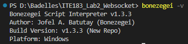
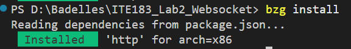
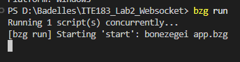
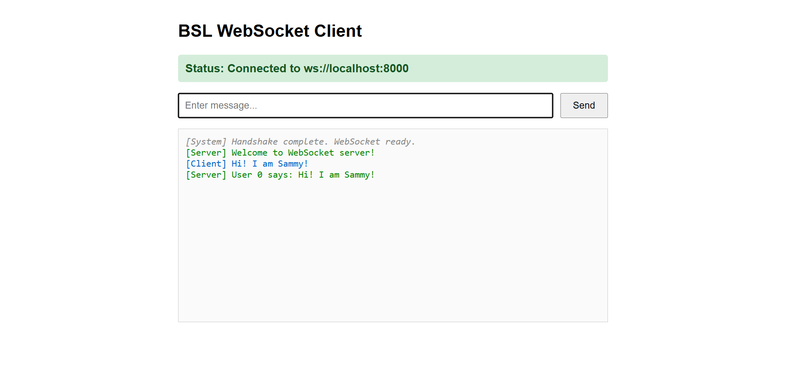
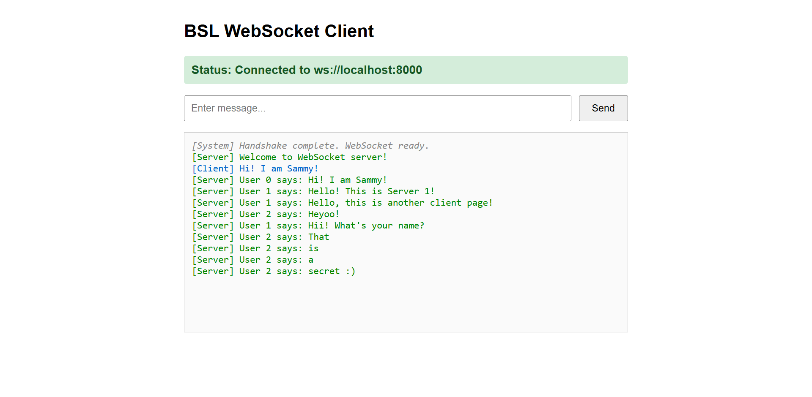
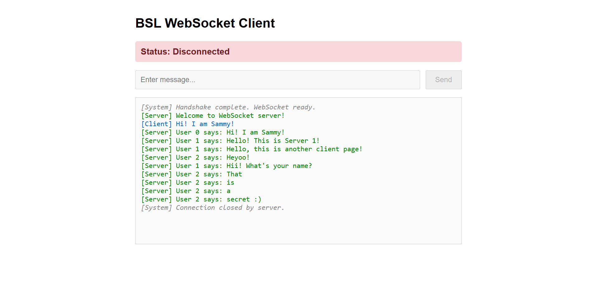
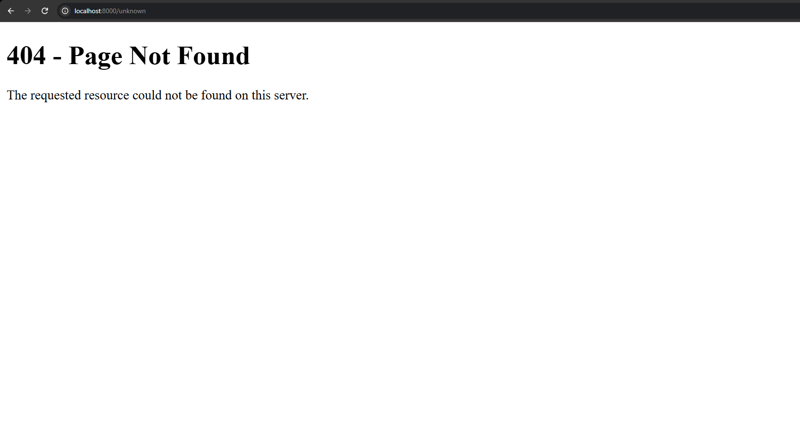

# ITE183 — Laboratory 2: WebSocket Server

A real-time, multi-client WebSocket chat application developed using **Bonezegei Scripting Language (v1.3.3)**.

This project is submitted as part of **Laboratory 2: WebSocket Server** for ITE183 — Web Systems and Technologies.

## Student Information
| **Name** | Samantha Shaina Julia N. Badelles |
| **Course Code** | ITE183 |
| **Section** | IT4D |

---

## 1. Project Overview

This project demonstrates the development of an event-driven WebSocket server using Bonezegei Scripting Language (BSL). It provides a real-time chat application where multiple browser clients can communicate through a persistent connection.

The application integrates HTTP request handling and WebSocket communication. The HTTP server serves the chat interface and a custom 404 page, while the WebSocket server manages connections, receives messages, and broadcasts them to active clients.

The project demonstrates fundamental concepts in asynchronous programming, full-duplex communication, client connection management, and real-time data exchange.

## 2. Laboratory Objectives

The project aims to:

1. Construct and run an event-driven WebSocket server using Bonezegei Scripting Language.
2. Implement WebSocket connection handling, including handshakes, client identification, and disconnection tracking.
3. Establish full-duplex communication between the server and connected clients.
4. Broadcast messages to multiple active browser clients in real time.
5. Serve static HTML pages using an HTTP server.
6. Display a custom 404 page for undefined routes.
7. Verify real-time communication across multiple browser windows.

## 3. Technologies Used

| Technology | Purpose |
|---|---|
| Bonezegei Scripting Language v1.3.3 | Server-side scripting and event handling |
| HTTP | Serving web pages and handling requests |
| WebSocket | Persistent, bidirectional communication |
| HTML5 | Structure of the chat interface |
| CSS3 | Styling and layout |
| JavaScript | Client-side WebSocket functionality |
| Git and GitHub | Version control and repository management |


## 4. Project Structure

```text
ITE183_Lab2_Websocket/
│
├── public/
│   ├── index.html                 # Main WebSocket chat interface
│   └── 404.html                   # Custom 404 page
│
├── screenshots/                   # Laboratory testing evidence
│   ├── 01_bonezegei_version.png   # Bonezegei v1.3.3 verification
│   ├── 02_dependency_installation.png  # Dependency installation
│   ├── 03_server_startup.png      # WebSocket server execution
│   ├── 04_client_connection.png   # Successful client connection
│   ├── 05_multiple_clients.png    # Simultaneous client connections
│   ├── 06_message_broadcasting.png # Real-time chat broadcasting
│   ├── 07_client_disconnection.png # Client disconnection tracking
│   └── 08_custom_404.png          # Custom 404 page rendering
│
├── app.bzg                        # HTTP and WebSocket server
├── package.json                   # Project configuration and dependencies
├── .gitattributes                 # GitHub language configuration
├── LICENSE                        # MIT License
└── README.md                      # Project documentation
```

### File Descriptions

- **`app.bzg`** — Contains the HTTP server, WebSocket connection handlers, message broadcasting logic, and server execution.
- **`package.json`** — Defines the project metadata, dependencies, and startup configuration.
- **`public/index.html`** — Provides the browser-based interface for connecting and exchanging messages.
- **`public/404.html`** — Displays a custom error page when an undefined route is requested.
- **`screenshots/`** — Stores the laboratory evidence documenting environment verification, server execution, WebSocket connections, real-time message broadcasting, disconnection tracking, and custom 404 page rendering.
- **`.gitattributes`** — Configures GitHub to recognize `.bzg` files as JavaScript for syntax highlighting.
- **`LICENSE`** — Contains the MIT License.
- **`README.md`** — Documents the project's implementation, setup, functionality, testing procedures, and supporting evidence.


## 5. Installation and Setup

### Prerequisites

Before running the application, ensure that the following are available:

- Bonezegei Scripting Language **v1.3.3**
- A modern browser supporting WebSockets
- A terminal or command-line interface
- Git (optional, for cloning the repository)

### Step 1: Install Bonezegei

**Windows**

1. Open the Microsoft Store.
2. Search for **Bonezegei**.
3. Install the required version.

**Linux / GitHub Codespaces**

Download the provided package:

```bash
wget https://github.com/bonezegei/Bonezegei_Scripting_Language/raw/refs/heads/main/Release/Latest/Bonezegei-x86.deb
```

Install the downloaded package:

```bash
sudo apt install ./Bonezegei-x86.deb
```

### Step 2: Verify Installation

Run:

```bash
bonezegei -v
```

Required version:

```text
Bonezegei v1.3.3
```

### Step 3: Clone the Repository

```bash
git clone https://github.com/[YOUR-USERNAME]/ITE183_Lab2_Websocket.git
```

Navigate to the project directory:

```bash
cd ITE183_Lab2_Websocket
```

### Step 4: Install Dependencies

```bash
bzg install
```

This installs the dependencies specified in `package.json`.

### Step 5: Run the Application

```bash
bzg run
```

Once the server is running, open:

**http://localhost:8000**

The server listens on port **8000** for HTTP and WebSocket connections.

> **Note:** Keep the terminal running while using the application. Stopping the server will disconnect active WebSocket clients.

---

## 6. System Architecture

The application follows a client-server architecture.

```text
                 HTTP / WebSocket Server
                    (app.bzg)
                  localhost:8000
                         |
             WebSocket Communication
                         |
          +--------------+--------------+
          |              |              |
      Browser A      Browser B      Browser C
       Client 1       Client 2       Client 3
          |              |              |
          +--------------+--------------+
                         |
                 Real-Time Message
                    Broadcasting
```

Each connected browser establishes an independent WebSocket connection with the server.

When a client sends a message:

1. The server receives the message.
2. The server identifies the sending client.
3. The message is processed by the server.
4. The server broadcasts the message to all active clients.
5. Connected browsers receive and display the broadcast.

This communication occurs without requiring users to refresh their browser pages.

## 7. Application Functionality

### 7.1 HTTP Request Handling

The application uses an HTTP server to handle incoming browser requests.

| Route | Behavior |
|---|---|
| `/` | Serves the main chat interface (`index.html`) |
| Undefined routes | Displays the custom `404.html` page |

The server uses `server.sendFile()` to serve the appropriate HTML file.

### 7.2 WebSocket Connection Management

The server manages client connections through event-driven handlers.

**Connection Event — `server.onConnect`**

Triggered when a client establishes a WebSocket connection.

Responsibilities:
- Detect a successful connection.
- Identify the connected client using its client ID.
- Log the connection in the terminal.
- Send a welcome message to the client.

**Message Event — `server.onData`**

Triggered when the server receives a message.

Responsibilities:
- Receive the incoming message.
- Identify the sending client.
- Log the message in the server terminal.
- Broadcast the message to connected clients.

**Disconnection Event — `server.onDisconnect`**

Triggered when a client disconnects.

Responsibilities:
- Identify the disconnected client.
- Log the disconnection event.
- Allow remaining clients to continue communicating.

### 7.3 Real-Time Message Broadcasting

The server distributes incoming messages to connected clients using:

```javascript
server.sendAll("User " + clientId + " says: " + message);
```

Unlike a direct response using `server.send()`, which targets a specific client, `server.sendAll()` broadcasts the message to all active connections.

This enables real-time multi-client communication.

### 7.4 Full-Duplex Communication

WebSocket supports full-duplex communication, meaning the client and server can independently send and receive messages through the same persistent connection.

This eliminates the need to initiate a separate HTTP request for every chat message.

### 7.5 Browser-Based Chat Interface

The frontend provides an interactive interface for exchanging WebSocket messages.

The laboratory's client implementation includes:

- Connection status display
- Message input field
- Send button
- Message log
- Incoming and outgoing message indicators
- Connection and disconnection notifications

The message input and send button are enabled when the WebSocket connection is established and disabled when the connection closes.

### 7.6 Custom 404 Page

When a browser requests an undefined route, the application displays `public/404.html`.

This provides a custom page instead of the main chat interface.

---

## 8. Testing and Verification

The following procedures are used to verify that the application meets the laboratory requirements.

### Test 1: Environment Verification

**Procedure:**

1. Open the terminal.
2. Execute `bonezegei -v`.
3. Check the installed version.

**Expected Result:** The terminal identifies Bonezegei version 1.3.3.

### Test 2: Dependency Installation and Server Startup

**Procedure:**

1. Navigate to the project directory.
2. Execute `bzg install`.
3. Execute `bzg run`.
4. Observe the terminal output.

**Expected Result:** Dependencies install successfully, and the server starts without errors.

### Test 3: WebSocket Connection

**Procedure:**

1. Open `http://localhost:8000`.
2. Wait for the client to establish its connection.
3. Observe the connection status and welcome message.
4. Check the terminal for the connected client ID.

**Expected Result:** A WebSocket connection is established, and the server recognizes the client.

### Test 4: Multi-Client Message Broadcasting

**Procedure:**

1. Open the application in at least two browser windows.
2. Confirm that both clients are connected.
3. Send a message from the first browser.
4. Check whether the message appears in the second browser.
5. Send another message from the second browser.
6. Verify that the broadcast is received by connected clients.

**Expected Result:** Messages are delivered to all active clients in real time without refreshing the browser.

### Test 5: Client Disconnection

**Procedure:**

1. Open multiple browser clients.
2. Close one browser window.
3. Observe the disconnection event in the terminal.
4. Send another message using a remaining client.

**Expected Result:** The disconnected client is logged, and the remaining clients continue communicating.

### Test 6: Custom 404 Page

**Procedure:**

1. Open a browser.
2. Navigate to `http://localhost:8000/unknown`.
3. Observe the page displayed.

**Expected Result:** The application displays its custom 404 page.

---


## 9. Laboratory Evidence

This section presents screenshots documenting the installation, execution, and testing of the WebSocket server. The evidence demonstrates the application's compliance with the laboratory requirements, including environment configuration, server startup, connection management, real-time message broadcasting, and HTTP error handling.

### 9.1 Environment Verification

**Figure 1. Bonezegei Version Verification**



*Figure 1. Terminal output of `bonezegei -v` confirming the installation of Bonezegei Scripting Language v1.3.3.*

**Filename:** `01_bonezegei_version.png`

---

### 9.2 Dependency Installation

**Figure 2. Dependency Installation**



*Figure 2. Terminal output showing the execution of `bzg install` and the installation of the required project dependencies.*

**Filename:** `02_dependency_installation.png`

---

### 9.3 WebSocket Server Startup

**Figure 3. Server Execution**



*Figure 3. Terminal output demonstrating the execution of `bzg run` to start the HTTP and WebSocket server on port 8000.*

**Filename:** `03_server_startup.png`

---

### 9.4 WebSocket Connection Establishment

**Figure 4. Successful Client Connection**



*Figure 4. Browser interface demonstrating a successful WebSocket connection and the server's welcome message.*

**Filename:** `04_client_connection.png`

---

### 9.5 Multi-Client Connection

**Figure 5. Multiple Connected Clients**

.png)
.png)
.png)

*Figure 5. Multiple browser windows connected simultaneously to the WebSocket server, demonstrating support for concurrent client connections.*

**Filename:** `05_multiple_clients(0).png`, `05_multiple_clients(1).png`, `05_multiple_clients.png(2)`

---

### 9.6 Real-Time Message Broadcasting

**Figure 6. Multi-Client Message Broadcasting**



*Figure 6. Real-time communication between connected clients, demonstrating that messages sent by one client are broadcast to all active WebSocket connections.*

**Filename:** `06_message_broadcasting.png`

---

### 9.7 Client Disconnection Tracking

**Figure 7. WebSocket Disconnection Event**



*Figure 7. Server terminal displaying a client disconnection event and its associated client ID.*

**Filename:** `07_client_disconnection.png`

---

### 9.8 Custom 404 Page

**Figure 8. Custom HTTP 404 Page**



*Figure 8. Browser displaying the application's custom 404 page when an undefined HTTP route is requested.*

**Filename:** `08_custom_404.png`

---

### 9.9 Testing Summary

The following table provides an overview of the laboratory's verification procedures.

| Test | Expected Result | Evidence |
|---|---|---|
| Version Verification | Bonezegei v1.3.3 is installed | Figure 1 |
| Dependency Installation | Required dependencies install successfully | Figure 2 |
| Server Startup | Server executes without errors using `bzg run` | Figure 3 |
| Client Connection | WebSocket connection and welcome message are established | Figure 4 |
| Multiple Clients | Multiple browser clients connect simultaneously | Figure 5 |
| Message Broadcasting | Messages are received by all active clients | Figure 6 |
| Client Disconnection | Disconnection events are logged by the server | Figure 7 |
| Custom 404 Page | Undefined routes display the custom 404 page | Figure 8 |


## 10. GitHub Repository Configuration

The repository is configured according to the laboratory specifications.

**Repository Name:**

```text
ITE183_Lab2_Websocket
```

**Visibility:** Public

**License:** MIT

**GitHub Language Configuration:**

The `.gitattributes` file contains:

```gitattributes
*.bzg linguist-language=JavaScript
```

This enables GitHub to display Bonezegei source files using JavaScript syntax highlighting.

## 11. Conclusion

This laboratory demonstrates the implementation of an event-driven WebSocket server using Bonezegei Scripting Language.

Through HTTP request handling, WebSocket connection management, and real-time message broadcasting, the project illustrates how persistent connections support bidirectional communication between a server and multiple browser clients.

The activity also provides practical experience with server execution, client lifecycle events, static file serving, and repository configuration.

## 12. License

This project is licensed under the **MIT License**. See the [LICENSE](LICENSE) file for more information.

---

**ITE183 — Web Systems and Technologies**  
**Laboratory 2: WebSocket Server**
